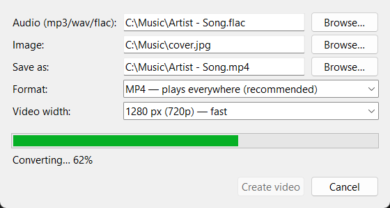

# Audio to Video

A desktop program that turns **a music file and a single image into a video**.
The video is exactly as long as the track, shows your image the whole time, and
keeps the audio lossless (or nearly so).

Handy for uploading music to YouTube and social networks.

- Input: **MP3 / WAV / FLAC** audio + an image of any resolution
  (JPG, PNG, BMP, WEBP, GIF, TIFF)
- Output: **MP4** (plays everywhere) or **MKV** (audio copied bit-for-bit)
- Fast export: 1 frame per second, image downscaled to 1280 px
- Simple window with buttons, plus a command-line interface
- ffmpeg is bundled, nothing else to install



## Quick start

### Option 1. Ready-made .exe (Windows, no Python needed)

1. Download `AudioToVideo.exe` from the [Releases](../../releases) page
   (or from the artifacts of the latest build on the *Actions* tab).
2. Double-click it.
3. Choose an audio file and an image, then click **Create video**.

### Option 2. From source (Windows / macOS / Linux)

Requires Python 3.10+.

```bash
git clone https://github.com/kryachkow/audio-to-video.git
cd audio-to-video
pip install .
audio-to-video-gui
```

Or without installing: `pip install -r requirements.txt`, then `python run_app.py`.

## Usage

### The window

| Field | What it does |
|---|---|
| **Audio** | Track in mp3, wav or flac format |
| **Image** | Picture shown for the whole video |
| **Save as** | Where to save. Filled in automatically next to the audio file |
| **Format** | MP4 for YouTube and any player; MKV keeps the audio completely unchanged |
| **Video width** | Smaller is faster. The image is never upscaled |

Progress is shown while converting, and **Cancel** stops the conversion.

### Command line

```bash
audio-to-video song.flac cover.jpg                 # -> song.mp4 next to the audio
audio-to-video song.wav cover.png -o clip.mkv -f mkv
audio-to-video song.mp3 cover.jpg -w 0 -y          # original size, overwrite
```

| Option | Default | Description |
|---|---|---|
| `-o, --output` | `<audio>.mp4` | Output file |
| `-f, --format` | `mp4` | `mp4` or `mkv` |
| `-w, --max-width` | `1280` | Maximum width, `0` keeps the original size |
| `--fps` | `1` | Frames per second |
| `-y, --overwrite` | — | Overwrite an existing file |
| `-q, --quiet` | — | No progress bar |

`python -m audio_to_video` without arguments opens the window; with arguments
it works as the command-line tool.

## How the audio is stored

| Input | MP4 | MKV |
|---|---|---|
| MP3 | copied without re-encoding (lossless) | copied without re-encoding |
| WAV | AAC (up to 320 kbit/s) | copied bit-for-bit (PCM) |
| FLAC | AAC (up to 320 kbit/s) | copied bit-for-bit (FLAC) |

If you need perfectly untouched audio from WAV/FLAC, choose **MKV**
(YouTube accepts it). More details in [docs/USER_GUIDE.md](docs/USER_GUIDE.md).

## Documentation

- [User guide](docs/USER_GUIDE.md): formats, tips, FAQ
- [Developer guide](docs/DEVELOPMENT.md): project layout, tests, building the .exe

## Development in short

```bash
pip install -e ".[dev]"
python -m pytest            # 62 tests: unit, integration with real ffmpeg, GUI
python build_exe.py         # -> dist/AudioToVideo.exe
```

## License

[MIT](LICENSE). ffmpeg is distributed under its own license (LGPL/GPL)
as part of the [imageio-ffmpeg](https://github.com/imageio/imageio-ffmpeg) package.
